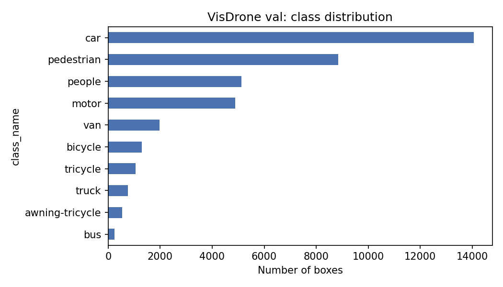
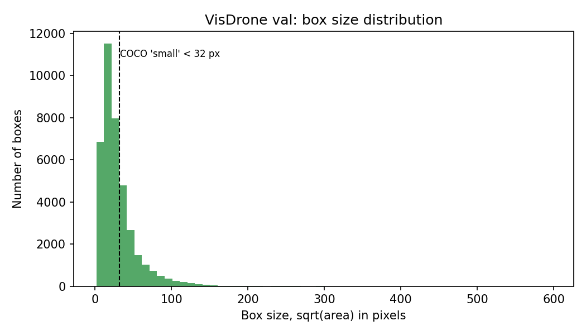

# Drone Label QA & Uncertainty Sampling (VisDrone)

> **Status: work in progress.** Automated label QA is done; model-assisted error finding and uncertainty sampling are next.

A small prototype of data-quality tools for drone object detection, built on the
[VisDrone2019-DET](https://github.com/VisDrone/VisDrone-Dataset) validation set
(548 drone images, 38,759 object boxes). The goal is the core loop of an ML data
pipeline: find broken labels automatically, use a model to find likely label errors,
and decide which images are worth labeling next.

## Progress

| Step | Status | What it does |
| --- | --- | --- |
| 1. Data loader | ✅ Done | `load_visdrone.py` loads all VisDrone labels into one pandas table (one row per box) |
| 2. Automated label QA | ✅ Done | `label_qa.py` runs rule-based checks and writes a report and 2 plots |
| 3. Model-assisted error finding | ⏳ To do | Compare a COCO-pretrained YOLO11s with the labels to flag candidate missing labels and misclassifications, then review the top flags by hand |
| 4. Uncertainty sampling | ⏳ To do | Rank images by model uncertainty and compare the top 50 with a random 50 |
| 5. Write-up | ⏳ To do | Results, figures and limitations for steps 3–4 |

## Step 2 results: automated label QA

| Check | Flagged |
| --- | --- |
| Object boxes checked | 38,759 (1,410 ignored regions and "others" excluded) |
| Zero or negative size | 0 |
| Out of bounds (box past the image edge) | 0 |
| Tiny boxes (< 4×4 px) | 102 (0.26%) |
| Near-duplicates (same class, IoU > 0.9) | 3 pairs |

- **Class imbalance:** car makes up 36% of boxes, bus only 0.6%, so a detector will be weakest on rare classes.
- **Small objects:** 68.6% of boxes are under 32×32 px (the COCO "small" definition). This is the main reason off-the-shelf detectors struggle on drone imagery.




## Run

```bash
pip install ultralytics pandas

# data (78 MB): VisDrone2019-DET validation split
mkdir -p data && cd data
curl -L -o val.zip https://github.com/ultralytics/assets/releases/download/v0.0.0/VisDrone2019-DET-val.zip
unzip -q val.zip && cd ..

python load_visdrone.py data/VisDrone2019-DET-val   # summary of the labels
python label_qa.py data/VisDrone2019-DET-val        # writes outputs/qa/
```

Outputs in `outputs/qa/`: `qa_report.md`, one CSV of flagged boxes per check,
`near_duplicates.csv`, and the two plots above.

## Next steps

- [ ] Run a COCO-pretrained YOLO11s over the images, save all detections to CSV
- [ ] Flag confident detections with no matching label (candidate missing labels) and class disagreements (candidate misclassifications)
- [ ] Review the top 20 flags by hand and report how many are real label errors
- [ ] Uncertainty sampling: score each image, select the top 50, compare with a random 50 and a baseline score
- [ ] Later: fine-tune on the selected vs random images and compare mAP, to close the active-learning loop

## Dataset

VisDrone2019-DET by the AISKYEYE team, Tianjin University
([github.com/VisDrone/VisDrone-Dataset](https://github.com/VisDrone/VisDrone-Dataset)),
for non-commercial research use. The dataset itself is not included in this repo.